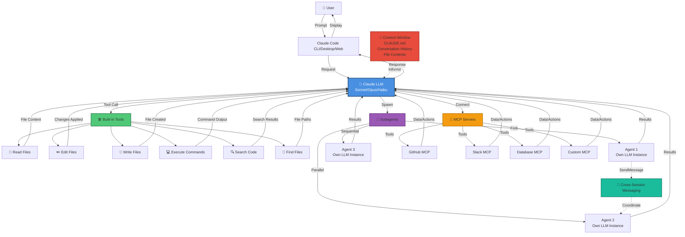

# Lab 3 - Code Editing and Testing

#### Duration: 30 minutes

## 🎯 Learning Objectives

By the end of this lab, you will:
- Master the Edit and Write tools for code modifications
- Generate comprehensive unit tests with AI assistance
- Refactor code while maintaining functionality
- Understand best practices for AI-assisted development
- Learn to iterate and improve AI-generated code

## 🍎 Scenario: Improving Code Quality at DataFlow Analytics

Your manager at DataFlow Analytics has identified several areas needing attention:

1. **Missing test coverage** - Critical functions lack unit tests
2. **Code improvements** - Some functions need refactoring for better readability
3. **Bug fixes** - A few edge cases aren't handled properly
4. **New features** - Add validation and error handling

Your task is to use Claude Code to efficiently address these issues while maintaining code quality.

## 🏗️ Understanding Claude Code Architecture

Before diving into code editing, let's understand how Claude Code works under the hood.

### Claude Code Execution Flow



### Key Components Explained

**1. Claude LLM (Language Model)**
- The brain of the operation
- Processes your requests and decides which tools to use
- Can be Sonnet (balanced), Opus (most capable), or Haiku (fastest)
- Maintains conversation context and project understanding

**2. Built-in Tools**
- **Read**: Examines file contents
- **Edit**: Makes surgical changes to existing files
- **Write**: Creates new files or rewrites existing ones
- **Bash**: Executes shell commands (run tests, build, etc.)
- **Grep**: Searches for code patterns across files
- **Glob**: Finds files matching patterns

**3. Subagents**
- Independent Claude instances you can spawn
- Each has its own LLM and tool access
- Work in parallel or sequentially
- Report results back to the main session
- Can coordinate via cross-session messaging

**4. MCP (Model Context Protocol) Servers**
- External integrations that extend Claude's capabilities
- GitHub: Access repos, PRs, issues
- Slack: Read/send messages, channel history
- Databases: Query and modify data
- Custom: Build your own integrations

**5. Context Window**
- Claude's working memory
- Includes conversation history, file contents, CLAUDE.md
- Managed via /compact, /clear, /context commands
- Automatically loads project instructions from CLAUDE.md

**6. Cross-Session Communication**
- Multiple Claude sessions can coordinate
- SendMessage tool enables agent-to-agent communication
- Useful for parallel work across different parts of a project

### Execution Flow Example

```
1. You: "Add error handling to the data processor"
   ↓
2. Claude LLM analyzes request
   ↓
3. Uses Read tool to examine data_processor.py
   ↓
4. Identifies functions needing error handling
   ↓
5. Uses Edit tool to add try-catch blocks
   ↓
6. Uses Bash tool to run tests
   ↓
7. Reviews test output
   ↓
8. Reports back: "Added error handling to 3 functions, all tests pass"
```

### Multi-Agent Example

```
1. You: "Review code for bugs, performance, and security"
   ↓
2. Claude spawns 3 parallel agents:
   Agent 1: Security review (Grep for SQL injection, XSS)
   Agent 2: Performance review (Grep for inefficient patterns)
   Agent 3: Bug review (Read code, analyze logic)
   ↓
3. Each agent runs independently with its own LLM
   ↓
4. Agents report findings back
   ↓
5. Main Claude aggregates results
   ↓
6. Reports: "Security: 2 issues, Performance: 4 issues, Bugs: 1 issue"
```

### MCP Integration Example

```
1. You: "Check if there are any related GitHub issues"
   ↓
2. Claude connects to GitHub MCP server
   ↓
3. MCP server queries GitHub API
   ↓
4. Returns issue list to Claude
   ↓
5. Claude: "Found 3 related issues: #123, #124, #125"
```

This architecture enables Claude Code to:
- 🚀 Work efficiently across multiple files and tasks
- 🔄 Coordinate parallel work via agents
- 🔌 Integrate with external systems via MCP
- 💾 Maintain context across long sessions
- 🛡️ Execute safely with permission controls

## 🔍 Step 1: Understanding Edit vs Write

Before we start, let's understand when to use each tool:

### Edit Tool
- **Purpose**: Make precise changes to existing files
- **Best for**: Modifying existing code, refactoring, bug fixes
- **How it works**: Finds exact text and replaces it
- **Safety**: Preserves surrounding code, surgical changes

### Write Tool
- **Purpose**: Create new files from scratch
- **Best for**: New files, complete rewrites, generated content
- **How it works**: Writes entire file contents
- **Safety**: Requires confirmation before overwriting existing files

**Rule of Thumb**: Always prefer Edit for existing files, Write for new files.

## 📝 Step 2: Your First Code Edit

Let's start with a simple example to understand the Edit workflow.

### Navigate to the Python Project

```bash
cd hol-claude-code-lab/SampleApps/python-data-processor
claude
```

### Task: Add a Docstring

Let's add documentation to a function that's missing it.

**Prompt to try:**
```
Find the data_processor.py file and add a comprehensive docstring to the main processing function if it's missing one. The docstring should include:
- Function description
- Parameters with types
- Return value
- Example usage
```

**What to observe:**
1. Claude uses `Read` to examine the file
2. Claude uses `Edit` to make the change
3. The edit shows exactly what was changed (old → new)
4. You can review before accepting

### Task: Fix a Bug

Now let's fix an actual issue in the code.

**Prompt to try:**
```
Review the data_processor.py file for edge cases in error handling. If a function doesn't handle empty input properly, add appropriate validation and error handling.
```

**Expected workflow:**
1. Claude reads and analyzes the code
2. Identifies the issue
3. Proposes a fix using Edit
4. Explains the reasoning

## 🧪 Step 3: Generating Unit Tests

Test generation is one of Claude Code's most powerful capabilities. Let's add comprehensive test coverage.

### Establish Baseline Coverage

First, let's see what tests already exist:

```
Show me all test files in this project and run the existing tests.
```

Claude should:
- Use Glob to find test files (test_*.py or *_test.py)
- Use Read to examine them
- Use Bash to run `pytest` or `python -m unittest`

### Generate Tests for Uncovered Code

Now let's add tests:

**Prompt to try:**
```
Analyze the test coverage for data_processor.py. Then generate comprehensive unit tests covering:
- Happy path scenarios
- Edge cases (empty input, invalid data)
- Error conditions
- Boundary conditions

Use pytest framework and follow best practices.
```

**What Claude will do:**
1. Read the source file to understand functionality
2. Read existing tests to understand patterns
3. Create new test file or extend existing one using Write/Edit
4. Generate test cases covering different scenarios

### Review Generated Tests

Always review AI-generated tests! Ask:

```
Explain the test cases you created. What scenarios does each test cover?
```

### Run the Tests

Verify the tests work:

```
Run the new tests and verify they pass. If any fail, debug and fix them.
```

**Key learning**: Claude can run tests, analyze failures, and fix issues autonomously!

## 🔨 Step 4: Refactoring Code

Refactoring improves code structure without changing behavior. Let's practice!

### Identify Refactoring Opportunities

```
Review data_processor.py and identify functions that could be refactored for better:
- Readability
- Maintainability
- Performance
- Separation of concerns

Suggest specific improvements.
```

### Apply Refactoring

Choose one suggestion and apply it:

**Example prompt:**
```
The process_data function is doing too many things. Refactor it by:
1. Extracting validation logic into a separate validate_data function
2. Extracting transformation logic into a transform_data function
3. Keeping the main function as a coordinator

Ensure all tests still pass after refactoring.
```

**What makes this prompt effective:**
- Specific about what to change
- Clear about the desired structure
- Includes validation requirement

### Verify Refactoring

After refactoring:
```
Run all tests to ensure the refactoring didn't break functionality. Show me the test results.
```

## 🎨 Step 5: Working with the Angular Application

Now let's apply these skills to the frontend code.

### Switch to Angular Project

```bash
exit  # Exit current session
cd ../angular-task-app
claude
```

### Task: Add a New Component Method

**Prompt to try:**
```
In the task-list component, add a method called filterCompletedTasks that filters the task list to show only completed tasks. Include:
- Proper TypeScript typing
- JSDoc comments
- Error handling for empty/null task lists
```

**Observe:**
- Claude reads the component file
- Uses Edit to add the method
- Maintains existing code style
- Adds proper typing

### Task: Generate Component Tests

Angular testing is more complex, but Claude handles it:

```
Generate comprehensive unit tests for the task-list component. Cover:
- Component initialization
- Method functionality (including the new filterCompletedTasks method)
- Input/Output bindings
- Template rendering
- Error scenarios

Use Jasmine and follow Angular testing best practices.
```

**What to look for:**
- Proper TestBed configuration
- Mock services where needed
- Tests for component state and DOM updates

### Task: Add Form Validation

```
In the task creation form, add client-side validation:
- Task title: required, min 3 chars, max 100 chars
- Task description: optional, max 500 chars
- Due date: required, must be in the future

Add appropriate error messages that display in the template.
```

**Claude should:**
1. Edit the component TypeScript file to add validators
2. Edit the template HTML to add error messages
3. Possibly edit styles for error display
4. Add tests for validation logic

## 🔬 Step 6: Advanced Editing Techniques

### Multi-File Edits

Claude can edit multiple related files:

```
Add a new feature: task priorities (low, medium, high). This requires:
1. Update the Task interface to include priority
2. Update the task creation form to include priority selection
3. Update the task list display to show priority with color coding
4. Add filtering by priority
5. Generate tests for the new functionality
```

**Observe how Claude:**
- Plans the changes across multiple files
- Makes coordinated edits
- Maintains consistency
- Tests the changes

### Iterative Improvement

If the first attempt isn't perfect:

```
The priority colors are hard to see. Use more distinct colors:
- Low priority: green
- Medium priority: orange  
- High priority: red

Also add an icon before each task showing priority.
```

**Key insight**: You can iterate until the result is exactly what you want!

## 💡 Step 7: Best Practices for Code Editing

### 1. Always Review Changes

Never blindly accept AI edits:
- Review the diff carefully
- Understand what changed and why
- Look for unintended modifications
- Verify edge cases are handled

### 2. Provide Context

Help Claude make better edits:
```
# ❌ Less effective
Add validation to the form

# ✅ More effective  
Add validation to the task creation form in task-create.component.ts.
Validate that title is required and between 3-100 characters.
Show error messages below the input field.
```

### 3. Test After Editing

Always verify changes work:
```
After making these changes, run the tests and start the dev server to verify everything works correctly.
```

### 4. Iterate and Refine

Don't expect perfection immediately:
1. Start with a working version
2. Test it
3. Refine based on issues
4. Repeat until satisfied

### 5. Maintain Code Style

Claude generally matches existing style, but verify:
```
Ensure the new code follows the existing code style and conventions in this file.
```

## 🎯 Exercise: Independent Practice

Now complete these exercises on your own!

### Exercise 1: Add Error Logging

**Task**: Add comprehensive error logging throughout the Python data processor.

**Prompt suggestion:**
```
Add proper error logging using Python's logging module to data_processor.py:
1. Configure logging at the module level
2. Add error logs for exception handling
3. Add info logs for major processing steps
4. Add debug logs for detailed flow tracking
5. Ensure tests still pass
```

### Exercise 2: Add Loading States

**Task**: Add loading indicators to the Angular app when data is being fetched.

**Prompt suggestion:**
```
In the task-list component:
1. Add a loading state property
2. Set it to true when fetching tasks from the API
3. Set it to false when data arrives or on error
4. Update the template to show a loading spinner when loading is true
5. Add tests for loading state management
```

### Exercise 3: Implement Input Validation

**Task**: Add validation to all data processing functions in Python.

**Prompt suggestion:**
```
Review all public functions in data_processor.py and add input validation:
- Type checking
- Null/empty checks
- Range validation where appropriate
- Raise ValueError with descriptive messages for invalid input
- Add tests for validation logic
```

### Exercise 4: Refactor for Testability

**Task**: Refactor a complex function to make it more testable.

**Prompt suggestion:**
```
The process_csv_data function in data_processor.py is complex and hard to test.
Refactor it by:
1. Extracting smaller, single-purpose functions
2. Making dependencies injectable
3. Reducing side effects
4. Updating existing tests
5. Adding new tests for the extracted functions
```

## 🧪 Exercise: Test-Driven Development (TDD)

Try writing tests BEFORE implementation:

```
Using TDD, add a new feature to validate email addresses in the data processor:
1. First, write failing tests for an email_validator function
2. Then implement the function to make tests pass
3. Refactor for clarity
4. Ensure all tests pass
```

## 🔍 Understanding Edit Tool Behavior

### How Edit Works

The Edit tool:
1. Searches for exact text match in the file
2. Replaces it with new text
3. Fails if text isn't found or isn't unique
4. Shows a clear diff of changes

### Common Edit Issues

**Issue: "Text not found"**
- The old text doesn't exactly match what's in the file
- Solution: Claude will re-read the file and try again

**Issue: "Text not unique"**
- Multiple places have the same text
- Solution: Claude provides more context to make it unique

**Issue: Changes didn't apply**
- File might have been modified elsewhere
- Solution: Claude re-reads and retries

## 📊 Tracking Your Changes

Good practices while editing:

### Use Git

```
Show me the current git status and diff to see all changes made.
```

### Commit Regularly

```
Create a commit with these changes. Write a descriptive commit message explaining what was added and why.
```

### Create Branches for Features

```
Create a new branch called 'feature/task-priorities' and switch to it before making these changes.
```

## 🎓 What You've Learned

By completing this lab, you now understand:

✅ **Edit vs Write** - When to use each tool

✅ **Test generation** - Creating comprehensive test suites with AI

✅ **Refactoring** - Improving code structure safely

✅ **Multi-file changes** - Coordinating edits across related files

✅ **Iterative development** - Refining AI-generated code

✅ **Best practices** - Reviewing, testing, and maintaining quality

## 🚀 Key Takeaways

1. **Edit is surgical, Write is complete** - Use the right tool for the job

2. **Always review AI changes** - Trust but verify

3. **Tests are your safety net** - Generate them early and run them often

4. **Iterate to perfection** - First version is rarely the final version

5. **Context makes better code** - Specific prompts get specific results

6. **Claude handles complexity** - Multi-file changes, refactoring, testing all work

## 📚 Additional Resources

- **Edit Tool Documentation**: [Edit Tool Reference](https://code.claude.com/docs/en/tools-reference#edit)
- **Testing Best Practices**: [Writing Tests](https://code.claude.com/docs/en/common-workflows#write-tests)
- **Refactoring Patterns**: [Code Quality](https://code.claude.com/docs/en/best-practices)

## 🔜 Next Steps

In [Lab 4 - Context Windows and Session Management](Lab-4-Context-Windows-and-Session-Management.md), you'll learn:
- Understanding and managing context windows
- Initializing CLAUDE.md for project-specific instructions
- Using slash commands: /clear, /compact, /context, /resume, and /handoff
- Optimizing your workflow with context management strategies

---

#### You have successfully completed Lab 3! Click [Next Lab →](Lab-4-Context-Windows-and-Session-Management.md) to continue.
